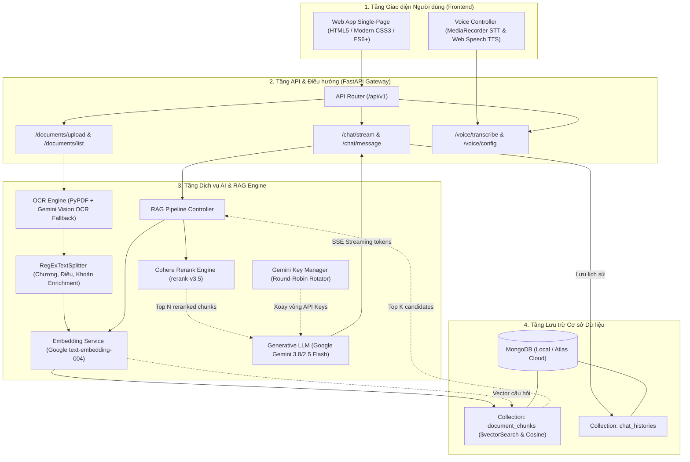

<<<<<<< HEAD
# NTU EduBot - Hệ thống AI Tra cứu Quy chế Học vụ Đại học Nguyễn Trãi (RAG)

<div align="center">
  
  <h3>TRỢ LÝ ẢO THÔNG MINH TRA CỨU QUY CHẾ ĐÀO TẠO & HỌC VỤ</h3>
  <p>Ứng dụng công nghệ <strong>Retrieval-Augmented Generation (RAG)</strong>, MongoDB Vector Search, Cohere Rerank và Google Gemini Flash</p>
  <p>
    <a href="#-kiến-trúc-hệ-thống-system-architecture">Kiến trúc</a> •
    <a href="#-công-nghệ-sử-dụng-tech-stack">Tech Stack</a> •
    <a href="#-cấu-trúc-thư-mục-directory-structure">Cấu trúc thư mục</a> •
    <a href="#-hướng-dẫn-khởi-chạy-nhanh-quick-start">Khởi chạy nhanh</a> •
    <a href="#-danh-mục-api-endpoints">API Endpoints</a> •
    <a href="backend/docs/API_REFERENCE.md">Tài liệu API Chi tiết</a>
  </p>
</div>

---

## 📖 1. Giới thiệu Tổng quan & Mục tiêu Đề tài

### 1.1. Bối cảnh
Quy chế đào tạo đại học theo học chế tín chỉ của **Trường Đại học Nguyễn Trãi (NTU)** bao gồm nhiều văn bản quy phạm chi tiết về: điều kiện đăng ký tín chỉ, thang điểm đánh giá, học lại/cải thiện, cảnh báo học vụ, xét cấp học bổng khuyến khích học tập và điều kiện nhận đồ án tốt nghiệp. Khi gặp vướng mắc, sinh viên thường mất nhiều thời gian tra cứu thủ công qua các file PDF dài hàng chục trang hoặc phải xếp hàng hỏi tại Phòng Quản lý Đào tạo.

### 1.2. Mục tiêu Giải pháp
**NTU EduBot** ra đời nhằm giải quyết triệt để vấn đề trên với các mục tiêu cốt lõi:
- **Chính xác tuyệt đối (Zero Hallucination)**: Ứng dụng kiến trúc RAG, chỉ trả lời dựa trên nội dung trích xuất từ văn bản quy chế chính thức, tuyệt đối không bịa đặt thông tin.
- **Dẫn chứng pháp lý rõ ràng**: Mọi câu trả lời của trợ lý AI đều bắt buộc trích dẫn cụ thể: *"Căn cứ theo Điều... Khoản... Quy chế..."* kèm thẻ nguồn và điểm số liên quan.
- **Hỗ trợ Đa phương thức (Multimodal)**: Tích hợp công nghệ OCR bóc tách tài liệu PDF/Scan ảnh, chuyển giọng nói thành văn bản (**Speech-to-Text**) và đọc câu trả lời thành tiếng (**Text-to-Speech**).
- **Trải nghiệm Streaming tức thì**: Phản hồi theo thời gian thực từng token qua giao thức **Server-Sent Events (SSE)**.
- **Tính sẵn sàng cao (High Availability)**: Trang bị cơ chế **Smart Offline Fallback** giúp hệ thống vẫn tự động trích dẫn quy chế từ MongoDB ngay cả khi API AI bên ngoài gặp sự cố mạng hoặc hết hạn mức.

---

## 🏛️ 2. Kiến trúc Hệ thống (System Architecture)

Sơ đồ quy trình xử lý dữ liệu và luồng hỏi đáp RAG:



---

## 🛠️ 3. Công nghệ Sử dụng (Tech Stack)

| Hạng mục | Công nghệ | Phiên bản / Mô tả |
|:---|:---|:---|
| **Backend Framework** | [FastAPI](https://fastapi.tiangolo.com/) | `>= 0.115.0` (High performance, async/await) |
| **ASGI Web Server** | [Uvicorn](https://www.uvicorn.org/) | `>= 0.30.0` (Chuẩn ASGI production) |
| **Database Driver** | [Motor](https://motor.readthedocs.io/) & [PyMongo](https://pymongo.readthedocs.io/) | Async MongoDB Driver |
| **Cơ sở dữ liệu** | **MongoDB Local** / **MongoDB Atlas** | Collections: `document_chunks`, `chat_histories` |
| **Vector Similarity** | Cosine Similarity (In-memory) / Atlas `$vectorSearch` | Tìm kiếm tương đồng ngữ nghĩa 768 chiều |
| **Generative LLM** | **Google Gemini Flash** | `gemini-3.8-flash` / `gemini-2.5-flash` qua SDK `google-genai` |
| **Embedding Model** | **Google Text Embedding** | `text-embedding-004` (768 dimensions) |
| **Reranking Engine** | **Cohere Rerank** | `rerank-v3.5` qua SDK `cohere` |
| **OCR & Document Parsing** | `pypdf`, `Pillow`, Gemini Vision OCR | Xử lý tài liệu PDF số và PDF scan dạng ảnh |
| **Kiểm định dữ liệu** | `Pydantic v2` & `pydantic-settings` | Quản lý cấu hình `.env` và schemas |
| **Frontend** | Vanilla HTML5, CSS3 Glassmorphism, Modern ES6+ JS | Không phụ thuộc framework ngoài, giao diện mượt mà |
| **Âm thanh** | Web Speech API & MediaRecorder | Thu âm Microphone và phát âm giọng đọc tiếng Việt |

---

## 📁 4. Cấu trúc Thư mục Dự án (Directory Structure)

```text
NTU-Edubot/
├── backend/
│   ├── app/
│   │   ├── api/
│   │   │   ├── v1/
│   │   │   │   ├── chat.py             # Endpoint hỏi đáp RAG SSE stream và non-stream
│   │   │   │   ├── document.py         # Endpoint tải lên, OCR, chia nhỏ và lập chỉ mục
│   │   │   │   └── voice.py            # Endpoint STT chuyển giọng nói và cấu hình TTS
│   │   │   └── router.py               # Central Router kết nối API v1
│   │   ├── core/
│   │   │   ├── config.py               # Pydantic Settings đọc cấu hình .env tự động
│   │   │   ├── key_manager.py          # Cơ chế Round-Robin xoay vòng đa API keys
│   │   │   └── security.py             # Cấu hình CORSMiddleware bảo mật kết nối
│   │   ├── db/
│   │   │   ├── mongodb.py              # Quản lý pool kết nối Motor bất đồng bộ
│   │   │   └── repositories/
│   │   │       ├── chat_repo.py        # Thao tác lưu & truy xuất lịch sử hội thoại
│   │   │       └── vector_repo.py      # Lưu trữ chunks, Atlas $vectorSearch & Cosine Fallback
│   │   ├── models/
│   │   │   ├── chat_model.py           # Pydantic schemas cho hội thoại và phiên chat
│   │   │   └── doc_model.py            # Pydantic schemas cho tài liệu và vector chunks
│   │   ├── services/
│   │   │   ├── ai/
│   │   │   │   ├── embedding.py        # Dịch vụ sinh vector với text-embedding-004
│   │   │   │   ├── llm.py              # Giao tiếp Gemini LLM kèm Smart Offline Fallback
│   │   │   │   ├── reranker.py         # Tái xếp hạng ngữ nghĩa qua Cohere Rerank v3.5
│   │   │   │   └── rag_pipeline.py     # Chuỗi quy trình RAG hoàn chỉnh (SSE streaming)
│   │   │   ├── ocr_service.py          # Bóc tách văn bản PDF và Gemini Vision OCR
│   │   │   └── voice_service.py        # Xử lý âm thanh đa phương thức
│   │   ├── utils/
│   │   │   ├── text_splitter.py        # Cắt văn bản thông minh (Chương, Điều, Khoản)
│   │   │   └── file_handler.py         # Quản lý lưu trữ và dọn dẹp file tạm an toàn
│   │   └── main.py                     # Khởi tạo FastAPI App, lifespan và mount StaticFiles
│   ├── data_sample/
│   │   └── quy_che_dao_tao_ntu.txt     # Bộ dữ liệu mẫu Quy chế Đào tạo tín chỉ NTU (UTF-8)
│   ├── data_temp/                      # Thư mục lưu file tải lên tạm thời
│   ├── docs/
│   │   └── API_REFERENCE.md            # Tài liệu kỹ thuật đặc tả chi tiết toàn bộ API
│   ├── .env.example                    # File mẫu khai báo các biến môi trường
│   ├── requirements.txt                # Danh mục các gói thư viện Python
│   ├── seed_ntu_data.py                # Script tự động nạp dữ liệu mẫu vào MongoDB
│   ├── setup_local_mongo.py            # Script khởi tạo database và indexes MongoDB Local
│   └── test_rag_e2e.py                 # Bộ kịch bản kiểm thử tích hợp End-to-End (E2E)
├── frontend/
│   ├── assets/
│   │   └── ntu-logo.svg                # Biểu trưng học thuật vector SVG Đại học Nguyễn Trãi
│   ├── css/
│   │   └── style.css                   # Thiết kế Modern Academic UI, Markdown, Badges
│   ├── js/
│   │   ├── api.js                      # Client SDK gọi RESTful & giải mã SSE streaming
│   │   ├── voice.js                    # Quản lý ghi âm Microphone STT và Web Speech TTS
│   │   └── main.js                     # Điều phối giao diện người dùng, Markdown và sự kiện
│   └── index.html                      # Giao diện chính Single-Page của NTU EduBot
├── .gitignore                          # Cấu hình loại trừ git cho Python, cache và dữ liệu tạm
├── README.md                           # Tài liệu kỹ thuật tổng quan đồ án
└── run_edubot.bat                      # Script 1-Click tự động hóa khởi chạy trên Windows
```

---

## ⚡ 5. Hướng dẫn Khởi chạy Nhanh (Quick Start)

### Cách 1: Khởi chạy Tự động 1-Click trên Windows (Khuyên dùng)
Tại thư mục gốc `NTU-Edubot/`, chỉ cần nhấp đúp chuột vào file:
👉 **`run_edubot.bat`**

File script sẽ tự động:
1. Tạo môi trường ảo `.venv` và cài đặt đầy đủ thư viện từ `requirements.txt`.
2. Kích hoạt môi trường và kiểm tra dữ liệu quy chế mẫu trong MongoDB.
3. Tự động nạp dữ liệu quy chế nếu cơ sở dữ liệu còn trống.
4. Tự động mở trình duyệt web tại [http://localhost:8000](http://localhost:8000).
5. Khởi chạy máy chủ FastAPI Backend.

---

### Cách 2: Khởi chạy Thủ công từng bước

#### Bước 1: Khởi tạo và kích hoạt Môi trường ảo
```bash
# Trên Windows:
python -m venv .venv
.\.venv\Scripts\activate

# Trên Linux / macOS:
python3 -m venv .venv
source .venv/bin/activate
```

#### Bước 2: Cài đặt các thư viện cần thiết
```bash
pip install --upgrade pip
pip install -r backend/requirements.txt
```

#### Bước 3: Thiết lập file cấu hình môi trường `.env`
Sao chép file mẫu `backend/.env.example` thành `backend/.env`:
```bash
# Trên Windows:
copy backend\.env.example backend\.env

# Trên Linux / macOS:
cp backend/.env.example backend/.env
```

Mở file `backend/.env` và thiết lập các tham số:
```env
APP_NAME="NTU EduBot API"

# MongoDB Local (Compass) hoặc MongoDB Atlas Cloud
MONGO_URI="mongodb://localhost:27017"
MONGO_DB_NAME="ntu_edubot_db"
VECTOR_COLLECTION="document_chunks"
CHAT_COLLECTION="chat_histories"
VECTOR_INDEX_NAME="vector_index"

# Gemini API Keys (Cho phép nhiều keys phân cách bằng dấu phẩy)
GEMINI_API_KEYS="AIzaSy...,AIzaSy..."

# Cohere API Key (Dùng cho bước Tái xếp hạng Rerank)
COHERE_API_KEY="your_cohere_api_key_here"

# Cấu hình Mô hình AI
EMBEDDING_MODEL="text-embedding-004"
LLM_MODEL="gemini-3.8-flash"
RERANK_MODEL="rerank-v3.5"
```

#### Bước 4: Khởi tạo Database & Nạp Dữ liệu Quy chế Mẫu
```bash
# Khởi tạo collections và indexes trong MongoDB:
python backend/setup_local_mongo.py

# Nạp dữ liệu Quy chế Học vụ Đại học Nguyễn Trãi vào cơ sở tri thức:
python backend/seed_ntu_data.py
```

#### Bước 5: Chạy Kiểm thử Tích hợp (E2E Integration Test)
```bash
python backend/test_rag_e2e.py
```

#### Bước 6: Khởi chạy Máy chủ Uvicorn
```bash
cd backend
uvicorn app.main:app --reload --host 0.0.0.0 --port 8000
```
Truy cập ứng dụng ngay tại:
- **Giao diện Web**: [http://localhost:8000](http://localhost:8000)
- **Tài liệu Swagger UI**: [http://localhost:8000/docs](http://localhost:8000/docs)

---

## 📡 6. Danh mục API Endpoints

Hệ thống cung cấp đầy đủ 10 RESTful & SSE Endpoints phục vụ toàn diện các nghiệp vụ:

| Nhóm | Phương thức | Endpoint | Chức năng |
|:---|:---:|:---|:---|
| **Hệ thống** | `GET` | `/health` | Kiểm tra tình trạng kết nối DB và số lượng Gemini API Keys |
| **Giao diện** | `GET` | `/` | Trả về trực tiếp giao diện Web Single-Page Application |
| **Hỏi đáp RAG** | `POST` | `/api/v1/chat/stream` | Hỏi đáp quy chế trả về dạng **Server-Sent Events (SSE)** |
| **Hỏi đáp RAG** | `POST` | `/api/v1/chat/message` | Hỏi đáp quy chế trả lời một lần (Non-streaming) kèm trích dẫn |
| **Hội thoại** | `GET` | `/api/v1/chat/history/{session_id}` | Truy xuất lịch sử hội thoại của một phiên |
| **Hội thoại** | `DELETE` | `/api/v1/chat/history/{session_id}` | Xóa sạch lịch sử tin nhắn của một phiên |
| **Quy chế** | `POST` | `/api/v1/documents/upload` | Tải lên tài liệu quy chế (PDF, Scan ảnh, Text) kèm OCR và Embedding |
| **Quy chế** | `GET` | `/api/v1/documents/list` | Liệt kê danh mục các văn bản quy chế đã được lập chỉ mục |
| **Quy chế** | `DELETE` | `/api/v1/documents/{doc_id}` | Xóa toàn bộ vector chunks của văn bản quy chế theo ID |
| **Giọng nói** | `POST` | `/api/v1/voice/transcribe` | Chuyển đổi âm thanh ghi âm thành chữ tiếng Việt (Gemini Multimodal STT) |
| **Giọng nói** | `GET` | `/api/v1/voice/config` | Cung cấp tham số cấu hình giọng đọc tiếng Việt cho Web Speech API |

👉 *Xem chi tiết Request Body Schema, Response JSON và giao thức SSE tại: [API_REFERENCE.md](backend/docs/API_REFERENCE.md)*.

---

## 🎯 7. Tính năng Nổi bật Dành cho Người dùng

1. **Giao diện Web Chuẩn Academic**:
   - Bố cục 2 cột tiện lợi: Cột trái quản lý kho tài liệu và tải lên quy chế mới; cột phải là không gian trò chuyện thông minh.
   - 4 thẻ câu hỏi gợi ý nhanh dựa trên các vấn đề sinh viên NTU quan tâm nhất (Học bổng, Cảnh báo học vụ, Học lại/Cải thiện điểm, Điều kiện làm đồ án).
2. **Trích dẫn Căn cứ Pháp lý Minh bạch**:
   - Mọi câu trả lời đều có bảng trích dẫn cụ thể tên Điều, tên Khoản, tên văn bản và điểm số liên quan (% Relevance).
   - Tự động làm nổi bật các từ khóa quy chế như `Điều 5`, `Khoản 2`, `CHƯƠNG I` dưới dạng huy hiệu màu trực quan.
3. **Dual-Mode Voice (Giọng nói 2 chiều)**:
   - Thu âm câu hỏi trực tiếp bằng Microphone (có hiệu ứng sóng âm động), chuyển thành văn bản tức thì bằng Gemini AI.
   - Nút "Nghe đọc" dưới mỗi câu trả lời kèm công tắc "Tự động đọc (Auto-TTS)" giúp sinh viên khiếm thị hoặc bận rộn dễ dàng tiếp cận thông tin.

---

## 📝 8. Giấy phép & Tác quyền (License)

Dự án phục vụ cộng đồng học sinh, sinh viên và cán bộ giảng viên **Trường Đại học Nguyễn Trãi (NTU)**.  
Toàn bộ mã nguồn được xây dựng chuẩn mực theo kiến trúc Clean Architecture, sẵn sàng mở rộng và tích hợp vào Cổng thông tin đào tạo của Nhà trường.
=======
# NTU-ChatBot
Backend: Python,MogoDB,Gemini API Frontend:JavaScript,HTML / CSS.
>>>>>>> 4bdaf8868c0a837c90d659e609d8252128b8a7ca
